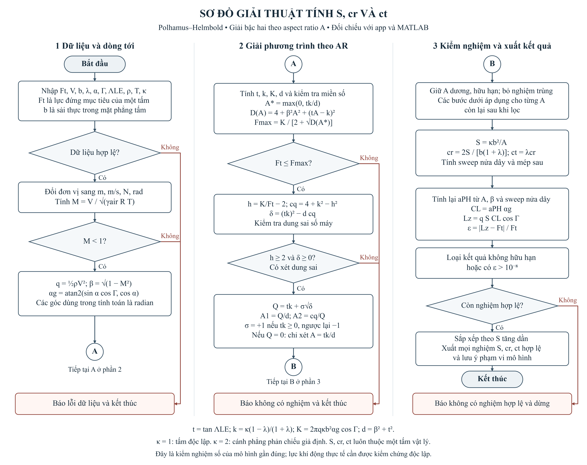

# Tính diện tích và dây cung cánh bằng Polhamus–Helmbold

Công cụ nghiên cứu tính diện tích planform `S`, dây gốc `cr` và dây đầu `ct`
của một tấm cánh hình thang, với tải đứng mục tiêu đã cho. Dự án gồm app HTML
chạy offline và mã MATLAB thực hiện cùng mô hình.

## Các tệp

| Tệp | Công dụng |
| --- | --- |
| `index.html` | App nhập thông số, xem kết quả, vẽ planform, xuất CSV và sinh script SpaceClaim cho NACA 0012 |
| `wing_dimensions_ph.m` | Hàm MATLAB giải phương trình bậc hai theo AR và kiểm tra lại lực đứng |
| `chay_tinh_canh_PH.m` | Script chạy mẫu, có các thông số đầu vào để chỉnh sửa |

## Sơ đồ giải thuật



[Bản SVG vector để phóng to hoặc chèn vào báo cáo](so-do-giai-thuat-ph.svg).
Các ký hiệu tròn A và B nối ba phần của cùng một quy trình.

## Chạy app

Mở `index.html` bằng Edge, Chrome hoặc Firefox. App là một tệp độc lập,
không cần máy chủ, MATLAB, Python hoặc kết nối Internet để tính toán.
Bộ thông số hợp lệ đã tính được lưu trong trình duyệt cho lần mở sau.
Các liên kết tài liệu tham khảo cần mạng khi được bấm mở.

Lần mở đầu tiên của app dùng góc tấn thân 3 độ và taper ratio 0,8.
Nút bộ mặc định trên giao diện giữ bộ dữ liệu tham chiếu ban đầu của mô hình;
có thể nhập lại mọi thông số trước khi tính.

Script CAD được sinh bởi app phải chạy trong Script Editor của
SpaceClaim 2025 R2, API V252. Nó không chạy bằng Python độc lập.

## Chạy MATLAB

Giữ hai tệp `.m` trong cùng thư mục. Mở `chay_tinh_canh_PH.m` và bấm Run.
Hoặc đặt Current Folder vào thư mục dự án và gọi:

```matlab
r = wing_dimensions_ph(struct('alphaDeg',3,'taper',0.8));
disp(r.roots)
```

Chỉnh các trường trong struct đầu vào để đổi lực mục tiêu, vận tốc, sải,
taper, góc tấn, dihedral, sweep, mật độ, nhiệt độ hoặc cánh tham chiếu.
Các trường không cung cấp sử dụng mặc định của hàm. Không cần Optimization Toolbox.

## Trường hợp tham chiếu

| Đại lượng | Giá trị |
| --- | --- |
| Lực đứng mục tiêu mỗi tấm | 87,5 gf |
| Vận tốc | 150 km/h |
| Sải thực của một tấm | 150 mm |
| Taper ratio | 0,8 |
| Góc tấn thân | 3 độ |
| Dihedral | 45 độ |
| Sweep mép trước trong mặt phẳng tấm | 20 độ |
| Mật độ không khí | 1,225 kg/m³ |
| Nhiệt độ | 288,15 K |
| Quy ước AR | Một tấm độc lập, `A = b²/S` |

Kết quả của mô hình cho một tấm:

| Đại lượng | Giá trị xấp xỉ |
| --- | --- |
| S | 141,709056 cm² |
| cr | 104,969671 mm |
| ct | 83,975737 mm |
| AR | 1,587760 |
| Lực đứng thế ngược | 87,5 gf |

Mã MATLAB đã được chạy trên R2023a. Đối chiếu số gồm trường hợp tham chiếu,
giải bằng `fzero` độc lập, đổi dấu dihedral, cánh phản chiếu giả định,
hai nghiệm dương, nghiệm kép và từ chối dữ liệu không hợp lệ.

## Thuật toán và giới hạn

1. Kiểm tra đầu vào và đổi sang SI, radian.
2. Tính áp suất động, Mach, hệ số nén và góc tấn hình học của tấm.
3. Quy phương trình lực Polhamus–Helmbold về bậc hai theo aspect ratio.
4. Giải bằng công thức ổn định số; chỉ giữ AR dương, hữu hạn và không trùng.
5. Khôi phục S, cr, ct; tính lại lực từ phương trình gốc.
6. Chỉ nhận nghiệm có phần dư tương đối không quá 1e-8 và trả về mọi nhánh hợp lệ.

Sải và diện tích luôn phải dùng cùng quy ước hình học. Tất cả kích thước
đầu ra thuộc một tấm vật lý. Đầu vào `arFactor = 2` là giả định cánh phẳng
phản chiếu, không tự xác nhận tương tác của hệ bốn cánh X.

Mô hình dùng độ dốc tiết diện lý tưởng 2π/rad, dòng dưới âm gần tuyến tính
và phép chiếu lực đứng gần đúng. Hệ số e = 0,8 không được tự đưa vào PH.
Tọa độ NACA 0012 phục vụ dựng hình, không phải polar khí động thực nghiệm.
AR thấp, chuyển tiếp, tách dòng, thân, đuôi, tương tác giữa các cánh và
dòng cánh quạt cần được nghiên cứu bằng mô hình phù hợp và dữ liệu đối chứng.
Phần dư nhỏ xác nhận phép tính theo mô hình, không chứng minh lực nâng thật.

## Mở app trên GitHub Pages

Sau khi các tệp ở thư mục gốc của nhánh `main` trên GitHub:

1. Mở Settings → Pages.
2. Chọn Source là Deploy from a branch.
3. Chọn nhánh `main` và thư mục `/(root)`, rồi Save.
4. Mở địa chỉ mà GitHub hiển thị tại trang Pages sau khi triển khai xong.

Tệp `.nojekyll` cho phép phục vụ các tệp tĩnh trực tiếp.
Với GitHub Free, dùng repository Public để sử dụng Pages.

## Tài liệu

- [NACA TN 3911 — Lowry và Polhamus, 1957](https://ntrs.nasa.gov/citations/19930084818)
- [NASA CR 157210 — công thức độ dốc lực nâng, mục 11.2](https://ntrs.nasa.gov/citations/19780017135)
- [Tạo repository GitHub](https://docs.github.com/en/repositories/creating-and-managing-repositories/creating-a-new-repository)
- [Tải tệp lên repository](https://docs.github.com/en/repositories/working-with-files/managing-files/adding-a-file-to-a-repository)
- [Cấu hình GitHub Pages](https://docs.github.com/en/pages/getting-started-with-github-pages/configuring-a-publishing-source-for-your-github-pages-site)
